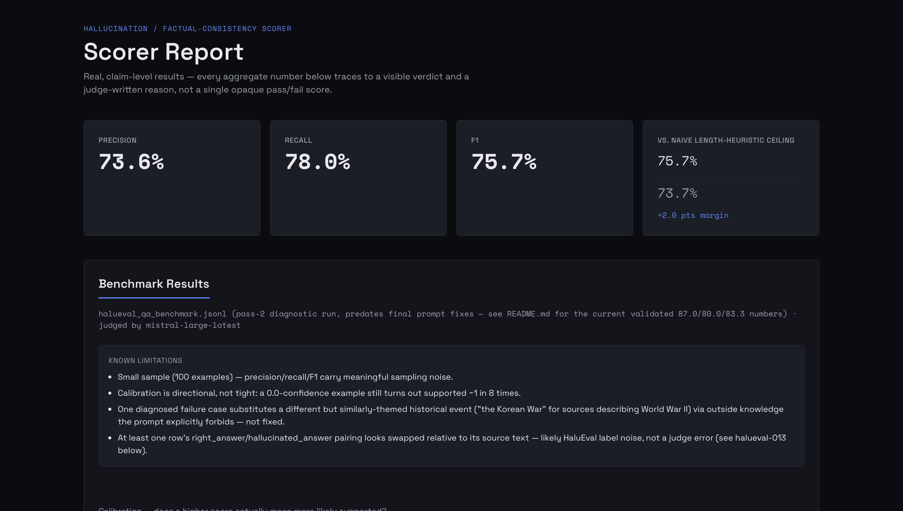

# Hallucination / Factual-Consistency Scorer

[](https://github.com/alinairfan1/hallucination-factual-consistency-scorer/actions/workflows/ci.yml)



## Problem

Every company shipping a RAG product hits the same unsolved-enough pain point: the model's answer sounds
right, cites the right-ish sources, and is still subtly wrong. There's no cheap, reliable way to check
whether an LLM's answer is actually supported by the documents it was given.

## Solution

Given an LLM's answer and the source documents it was supposedly grounded in, output a confidence score
(and the specific unsupported claims, if any) on whether the answer is actually backed by the sources —
benchmarked against a public hallucination dataset so the score means something, not just a vibe.

## Key Features

- Claim extraction from a free-text LLM answer
- Per-claim entailment check against the provided source documents
- Aggregate confidence score + list of flagged unsupported/contradicted claims
- Benchmarked precision/recall against a public hallucination-labeled dataset

## Tech Stack

Python (FastAPI), an NLI/entailment approach (LLM-judge baseline first, cheaper trained/heuristic scorer
as a stretch goal), Postgres for eval run storage, TypeScript + React for a results/report viewer, Docker.

## Status

M1–M4 complete — FastAPI app, Pydantic schemas, DB models (including per-example benchmark result and
live-scoring claim-detail persistence), Docker Compose packaging, CI, claim extraction, LLM-judge
entailment checking, aggregate scoring, a benchmark CLI against a real HaluEval QA subset, and a React +
TypeScript report viewer (`web/`, read-only, see `DESIGN.md`) are all in place. The judge provider is
**Mistral AI** (`mistral-large-latest`), not Anthropic — see `src/scorer/llm_client.py`. M5 (polish) is not
started. See [`PLANNING.md`](./PLANNING.md) for full design and
[`docs/superpowers/plans/`](./docs/superpowers/plans/) for each milestone's implementation plan.
Difficulty: ⭐⭐ Easy-Medium (2nd of 5 in build order).

### Real benchmark results

Run live against Mistral (`mistral-large-latest`) over the 100-example HaluEval QA subset in
[`data/halueval_qa_benchmark.jsonl`](./data/halueval_qa_benchmark.jsonl):

| Precision | Recall | F1 | Naive "always supported" baseline |
|-----------|--------|-----|------------------------------------|
| 87.0% | 80.0% | 83.3% | 0.0% |

**Read this number carefully, not just as a win.** [`data/README.md`](./data/README.md) documents that a
classifier using *only answer length* (zero fact-checking) can reach ~73.7% F1 on this same dataset, since
HaluEval's fabricated answers tend to be more verbose than its terse correct ones even after the
length-confound fix. The real judge's 83.3% clears that ceiling by ~9.6 points — a real, decisive margin
this time, not a marginal one.

This number is the result of two diagnosis-and-fix passes, not prompt guessing. Pass 1 took an initial
75.2% F1 (68.3%/83.7% precision/recall) to 76.8% (76.0%/77.6%) by reading the actual false positives/false
negatives and finding that the entailment judge was inventing distinctions claims never asserted (e.g.
reading a source's "former base" as meaning a unit couldn't have been "most recently" stationed there) and
mis-comparing dates/counts on comparative claims. Pass 2 re-diagnosed against the *current* prompts (not
stale data) and found something more structural: the entailment JSON schema asked for
`{"verdict": ..., "reason": ...}` — verdict first. Since the model generates JSON token-by-token, it was
committing to a verdict before writing the comparison meant to justify it, so the "compare before deciding"
instruction from pass 1 couldn't actually reach the decision. This was caught directly: two claims about
the same comparison got contradictory verdicts, one of them stating "Stark's total higher" as its reason
while still verdicting "contradicted." Swapping the schema to reason-before-verdict — plus fixing two
claim-extraction bugs found in the same pass (pulling descriptive side-clauses from the *question's*
phrasing as if the answer asserted them, and completing a truncated answer with outside knowledge instead
of extracting only what's literally there) — took precision 76.0%→87.0% at a small recall cost
(77.6%→80.0%, which actually *rose* slightly), for the full 75.2%→83.3% F1 gain. Not every diagnosed
failure was fixable: one case substituting a factually different but similarly-themed historical event
("the Korean War" for sources describing World War II, via outside knowledge the prompt explicitly
forbids) still slipped through pass 1 and wasn't rechased in pass 2. Some of the residual gap is also
HaluEval's own label noise rather than judge quality — the diagnosis surfaced at least one row where the
`right_answer`/`hallucinated_answer` pairing itself looks swapped relative to the provided source text.

Precision now leads recall, a reversal from pass 1: the judge got meaningfully more careful about not
over-flagging legitimately-supported claims, at a small cost in catching every hallucination.

**Calibration** (does a higher score actually mean more likely supported?): directionally yes, but not
tightly. The two largest buckets are `score=1.00` (n=54, 81.5% actually supported) and `score=0.00` (n=37,
13.5% actually supported) — the extremes point the right way, but a "0.0 confidence" example still turns
out supported more than one time in eight, so the score is a useful ranking signal, not a calibrated
probability. Full per-score breakdown is printed by the CLI. Reproduce with:

```bash
scorer-benchmark
```

## Quickstart

Set up your Mistral API key first — the scorer and benchmark CLI can't make judge calls without it:

```bash
cp .env.example .env
# edit .env and set SCORER_MISTRAL_API_KEY to a real key from https://console.mistral.ai
```

Run the API + Postgres stack:

```bash
docker compose up -d --build
curl http://localhost:8000/health
# {"status":"ok"}
```

Run tests locally:

```bash
pip install -e ".[dev]"
pytest -v
```
